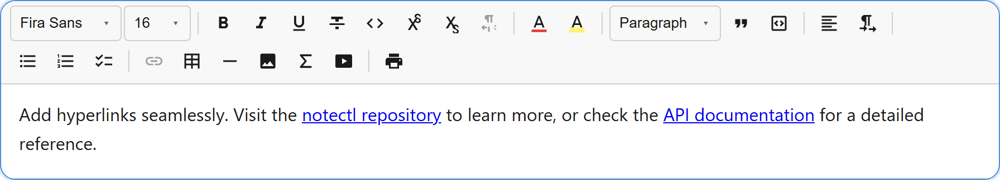
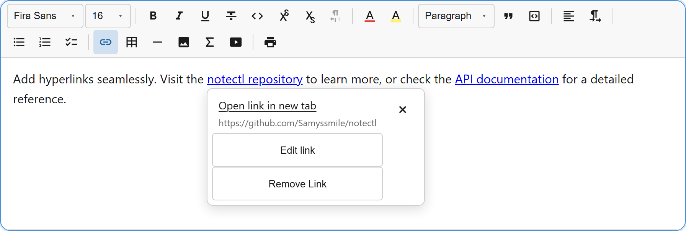

The `LinkPlugin` adds hyperlink support with a toolbar button that opens a URL input popup.



## Usage

```ts
import { LinkPlugin } from '@notectl/core/plugins/link';

new LinkPlugin()
// or:
new LinkPlugin({ openInNewTab: true })
```

## Configuration

```ts
interface LinkConfig {
  /** Whether non-fragment links open in a new tab (adds target="_blank"). Default: true */
  readonly openInNewTab: boolean;
  /** Custom locale for toolbar labels and popup strings. */
  readonly locale?: LinkLocale;
}
```

## Commands

| Command | Description | Returns |
|---------|-------------|---------|
| `toggleLink` | Remove an existing link; creation requires the URL form | `boolean` |
| `removeLink` | Remove link mark from selection | `boolean` |
| `openLink` | Open the link at the current selection; a new tab while editing, the configured target in readonly mode | `boolean` |
| `showLinkBubble` | Open link actions, or the URL form for selected unlinked text | `boolean` |
| `setLink` | Reserved — link is applied via the toolbar popup | `false` |

The toolbar button is enabled for a text range selection and for a collapsed cursor inside a link.
For an existing link, its popup offers **Open**, **Edit**, and **Remove**.

```ts
editor.executeCommand('toggleLink');
editor.executeCommand('removeLink');
```

## Keyboard Shortcuts

| Shortcut | Action |
|----------|--------|
| `Ctrl+K` / `Cmd+K` | Open link actions, or the URL form for selected text |
| `Alt+Enter` | Open the link at the cursor |

`Alt+Enter` follows the Google Docs convention. It does not collide with `Ctrl+Enter`, which host
applications often reserve for submitting a form and which the checklist plugin uses to toggle an item.

## Opening Links

While editing, **Ctrl-click** (Windows/Linux) or **Cmd-click** (macOS) opens a link in a new tab.
This explicit new-tab gesture takes precedence over `openInNewTab: false`.

A normal click or touch tap on a link shows a bubble with its destination and **Open**, **Edit**,
and **Remove** actions. Moving the caret into a link with the keyboard shows the same bubble.
The caret stays in the text: typing dismisses the bubble and continues editing.

Press **Tab** to enter the actions, use **Arrow keys**, **Home**, or **End** to move between them,
and **Enter** to activate. **Escape** closes the bubble and returns to editing. After dismissal,
it stays closed until the caret leaves and re-enters the link, or you press **Ctrl+K / Cmd+K**.
Double-clicking and selecting text do not open the contextual bubble.

**Edit** prefills the URL form. Apply a valid URL with **Enter** or **Apply**, or cancel with **Escape**.
Editing updates the whole link, including differently formatted text, while preserving its title
and formatting. Edit and Remove each undo in one step. A selection within one link targets that
whole link; mixed selections retain the insertion/range workflow.



The bubble follows its link during scrolling and viewport changes and closes when the link leaves
the editor's visible area. The editor announces it through its live region. The same actions and
URL form work without a toolbar through **Ctrl+K / Cmd+K**.

**Every open action taken while editing targets a new tab**, so unsaved work stays in place: the
bubble, Ctrl-/Cmd-click, `Alt+Enter`, the toolbar's **Open link** button and the `openLink`
command all ignore `openInNewTab: false`. The setting still governs rendered links, so readers in
readonly mode follow it.

In **readonly mode**, links use normal browser behavior: a single click or tap opens the URL,
the pointer cursor identifies links, and focused links can be activated with **Enter**. Browser
modifier keys and context menus remain available. Changing readonly mode closes any open bubble.

Bubble labels are localized. Existing custom `LinkLocale` objects remain compatible; the optional
`openLink`, `openLinkInNewTab`, `editLink`, `closeBubble`, and `bubbleOpened` strings fall back to English
when omitted.

## Toolbar

The link button opens a **custom popup** with:
- A URL input field with placeholder text
- An Apply button to confirm the link
- When the cursor is inside an existing link: "Open", "Edit", and "Remove" actions

## Mark Spec

| Mark | HTML Tag | Attributes | Renders As |
|------|----------|-----------|-----------|
| `link` | `<a>` | `href: string` | `<a href="...">` with optional `target="_blank"` |

When `openInNewTab` is `true`, the `toDOM` method adds `target="_blank"` and
`rel="noopener noreferrer"` to rendered non-fragment links.

## Document-Local Links

Fragment-only URLs such as `#installation` target a block whose
[`htmlId`](/notectl/api/document-model/#internal-id-vs-html-id) is `installation`:

```ts
await editor.setContentHTML(`
  <p><a href="#installation">Go to installation</a></p>
  <h2 id="installation">Installation</h2>
`);
```

An unmodified left click resolves the target inside the same editor and scrolls it into view. Such
links never receive `target="_blank"`, even when `openInNewTab` is enabled. The target is the
semantic HTML `id`; the editor's internal `BlockNode.id` and `data-block-id` are not anchor names.
While editing, Ctrl-/Cmd-click and the `openLink` command also resolve fragments inside this editor.

HTML import and export preserve both sides of the link, including clean export with
`includeBlockIds: false`. The PrintPlugin projects targets across its print shadow boundary so
fragment links remain document-local in print output and generated PDFs. Markdown export preserves
block targets through the default `htmlFallback: true`; disabling the fallback drops `htmlId`
because portable Markdown has no syntax for an ID on a block. See the
[Markdown guide](/notectl/guides/markdown/#superset-features-html-fallback-vs-graceful-degradation).

## Programmatic Link Insertion

To add a link programmatically without the popup:

```ts
import { markType } from '@notectl/core';

// Select text first, then apply the link mark
const state = editor.getState();
const { anchor, head } = state.selection;
const tr = state.transaction('api')
  .addMark(
    anchor.blockId,
    anchor.offset,
    head.offset,
    { type: markType('link'), attrs: { href: 'https://example.com' } }
  )
  .build();
editor.dispatch(tr);
```
