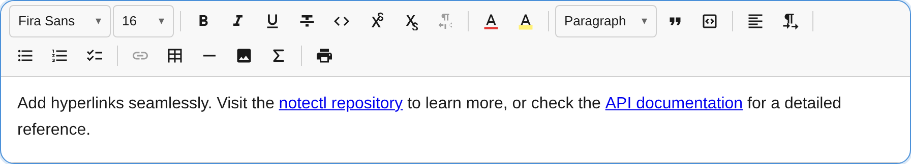

The `LinkPlugin` adds hyperlink support with a toolbar button that opens a URL input popup.



## Usage

```ts
import { LinkPlugin } from '@notectl/core/plugins/link';

new LinkPlugin()
// or:
new LinkPlugin({ openInNewTab: true })
```

## Configuration

```ts
interface LinkConfig {
  /** Whether non-fragment links open in a new tab (adds target="_blank"). Default: true */
  readonly openInNewTab: boolean;
  /** Custom locale for toolbar labels and popup strings. */
  readonly locale?: LinkLocale;
}
```

## Commands

| Command | Description | Returns |
|---------|-------------|---------|
| `toggleLink` | Add or remove a link on the selection | `boolean` |
| `removeLink` | Remove link mark from selection | `boolean` |
| `openLink` | Open the link at the current selection (also allowed in readonly mode) | `boolean` |
| `setLink` | Reserved — link is applied via the toolbar popup | `false` |

The toolbar button is enabled for a text range selection and for a collapsed cursor inside a link.
For an existing link, its popup offers **Open link** and **Remove Link**.

```ts
editor.executeCommand('toggleLink');
editor.executeCommand('removeLink');
```

## Keyboard Shortcuts

| Shortcut | Action |
|----------|--------|
| `Ctrl+K` / `Cmd+K` | Toggle link (opens URL popup if adding) |
| `Ctrl+Enter` / `Cmd+Enter` | Open the link at the cursor |

## Opening Links

While editing, **Ctrl-click** (Windows/Linux) or **Cmd-click** (macOS) opens a link in a new tab.
This explicit new-tab gesture takes precedence over `openInNewTab: false`.

A normal click or touch tap on a link shows a compact preview with its destination and an
**Open link** action. The editing caret stays in the text, so typing continues normally and closes
the preview. Press **Tab** to focus its open action and **Enter** to follow the link, or **Escape**
to dismiss it. The open action and `openLink` command respect `openInNewTab` (default: `true`).
Double-clicking or selecting text does not activate the link.

In **readonly mode**, links use normal browser behavior: a single click or tap opens the URL,
the pointer cursor identifies links, and focused links can be activated with **Enter**. Browser
modifier keys and context menus remain available. Changing readonly mode closes any open preview.

Preview labels are localized. Existing custom `LinkLocale` objects remain compatible; the optional
`openLink`, `openLinkInNewTab`, and `closePreview` strings fall back to English when omitted.

## Toolbar

The link button opens a **custom popup** with:
- A URL input field with placeholder text
- An Apply button to confirm the link
- When the cursor is inside an existing link: "Open link" and "Remove Link" actions

## Mark Spec

| Mark | HTML Tag | Attributes | Renders As |
|------|----------|-----------|-----------|
| `link` | `<a>` | `href: string` | `<a href="...">` with optional `target="_blank"` |

When `openInNewTab` is `true`, the `toDOM` method adds `target="_blank"` and
`rel="noopener noreferrer"` to rendered non-fragment links.

## Document-Local Links

Fragment-only URLs such as `#installation` target a block whose
[`htmlId`](/notectl/api/document-model/#internal-id-vs-html-id) is `installation`:

```ts
await editor.setContentHTML(`
  <p><a href="#installation">Go to installation</a></p>
  <h2 id="installation">Installation</h2>
`);
```

An unmodified left click resolves the target inside the same editor and scrolls it into view. Such
links never receive `target="_blank"`, even when `openInNewTab` is enabled. The target is the
semantic HTML `id`; the editor's internal `BlockNode.id` and `data-block-id` are not anchor names.
While editing, Ctrl-/Cmd-click and the `openLink` command also resolve fragments inside this editor.

HTML import and export preserve both sides of the link, including clean export with
`includeBlockIds: false`. The PrintPlugin projects targets across its print shadow boundary so
fragment links remain document-local in print output and generated PDFs. Markdown export preserves
block targets through the default `htmlFallback: true`; disabling the fallback drops `htmlId`
because portable Markdown has no syntax for an ID on a block. See the
[Markdown guide](/notectl/guides/markdown/#superset-features-html-fallback-vs-graceful-degradation).

## Programmatic Link Insertion

To add a link programmatically without the popup:

```ts
import { markType } from '@notectl/core';

// Select text first, then apply the link mark
const state = editor.getState();
const { anchor, head } = state.selection;
const tr = state.transaction('api')
  .addMark(
    anchor.blockId,
    anchor.offset,
    head.offset,
    { type: markType('link'), attrs: { href: 'https://example.com' } }
  )
  .build();
editor.dispatch(tr);
```
